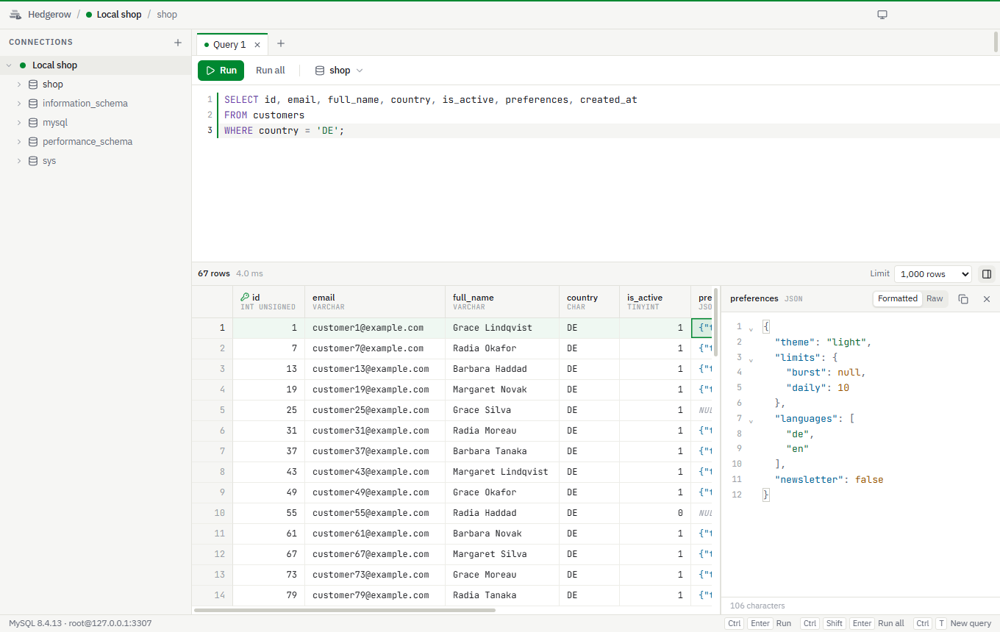
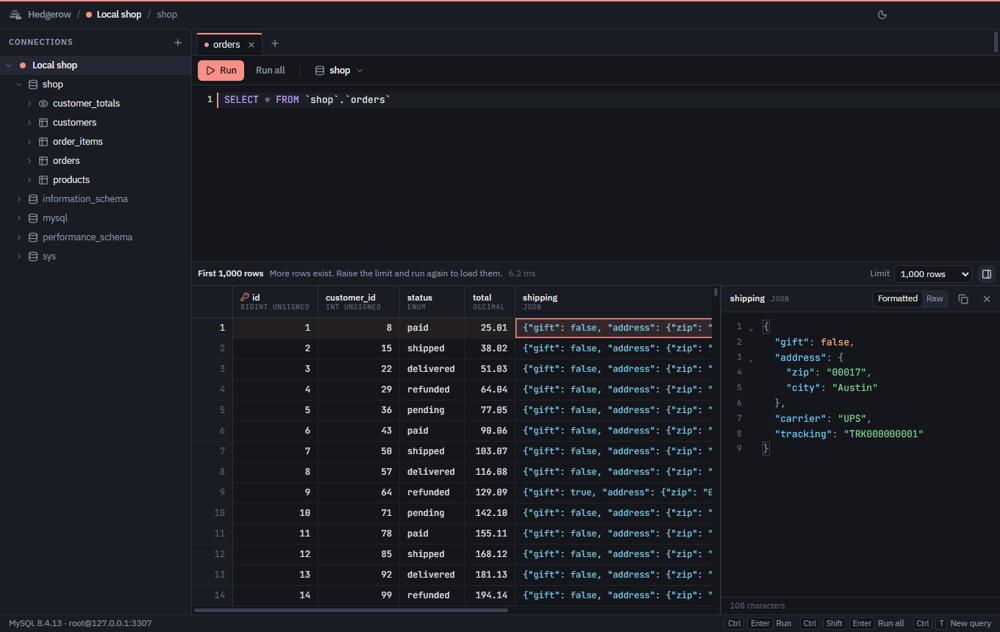

<p align="center">
  
</p>

# Hedgerow

[](https://github.com/nalyDzzz/hedgerow/actions/workflows/ci.yml)

An open-source desktop SQL client for Windows, macOS and Linux. No paid tier, no locked features.

A hedgerow is a row of shrubs that divides fields. A database table is rows and fields.



The project is early: MySQL works today, and the driver layer is built so PostgreSQL, SQLite and others can
be added without touching the UI.

## What works

- Saved connections, with passwords encrypted by the operating system's keychain
- A schema tree: databases, tables, views, columns and keys
- A SQL editor with MySQL syntax, schema-aware autocomplete and multiple tabs
- Run the statement under the cursor, the selection, or the whole tab; stop a running statement
- A results grid that stays fast on large results, with resizable columns and keyboard navigation
- A value panel that formats JSON, including JSON stored in text columns, without altering numbers
- Edit cells and delete rows in the results grid. Changes are staged, you see the exact SQL before it runs,
  and a save is one transaction that takes effect only if every statement changes exactly one row
- A color per connection that tints the window, so production never looks like local
- A notice when a newer version is out, with a button that downloads it
- Light and dark themes

Values are shown exactly as stored: large integers and decimals keep every digit, and dates are not
shifted into your timezone.



Each connection has a color. This one is marked red, so there is no mistaking it for a local database.

## Get it

Download the latest version from the [releases page](https://github.com/nalyDzzz/hedgerow/releases/latest).

| System | File to download |
| --- | --- |
| Windows | `Hedgerow-…-win-x64.exe` |
| macOS, Apple silicon | `Hedgerow-…-mac-arm64.dmg` |
| macOS, Intel | `Hedgerow-…-mac-x64.dmg` |
| Linux | `Hedgerow-…-linux-x86_64.AppImage` |

The builds are not code-signed yet ([#7](https://github.com/nalyDzzz/hedgerow/issues/7)), so each system
asks for one extra step the first time:

- **Windows:** SmartScreen says it protected your PC. Choose **More info**, then **Run anyway**.
- **macOS:** the first launch is blocked. Open **System Settings → Privacy & Security** and choose
  **Open Anyway**. If that button does not appear, run
  `xattr -dr com.apple.quarantine /Applications/Hedgerow.app` in Terminal.
- **Linux:** make the file executable with `chmod +x`, then run it. On Ubuntu 23.10 and later an AppImage
  may stop with a sandbox error; starting it with `--no-sandbox` works around that, at the cost of turning
  Chromium's sandbox off.

Each release lists SHA-256 checksums in `SHA256SUMS.txt`.

Hedgerow tells you when a newer version is out and offers its download; it does not install anything by
itself. To find out, it asks GitHub which release is the latest. That request names the app and nothing
else: no version, no system, nothing about you or your databases. You can turn the check off where it is
shown, by clicking the version number in the bottom right corner.

## Run it from source

You need [Node.js](https://nodejs.org) 24 and [pnpm](https://pnpm.io). The repository pins its pnpm version
in `package.json`, and pnpm switches to it by itself.

```sh
pnpm install
pnpm dev
```

`pnpm dev` opens the app with hot reload. `pnpm build` produces the production bundle in `out/`, and
`pnpm start` runs that bundle.

### A database to try it on

```sh
docker run -d --name hedgerow-mysql-dev -e MYSQL_ROOT_PASSWORD=devpass -p 127.0.0.1:3307:3306 mysql:8.4
docker exec -i hedgerow-mysql-dev mysql -uroot -pdevpass < dev/sample-data.sql
```

Then add a connection to `127.0.0.1`, port `3307`, user `root`, password `devpass`. The sample data is a
small shop: customers, products and 2,500 orders with JSON columns.

### Build an installer

```sh
pnpm dist
```

This builds an installer for the operating system you run it on and puts it in `dist/`: an `.exe` setup on
Windows, a `.dmg` on macOS, an AppImage on Linux. `pnpm package` builds the app unpacked instead, which is
quicker when you only want to try the packaged build.

`pnpm smoke` then starts the packaged app and checks that it works. CI does this on all three systems for
every change.

### Making a release

Set the version in `package.json`, merge that, then push a matching tag:

```sh
git tag v0.2.0
git push origin v0.2.0
```

CI builds and tests the installers and attaches them to a draft release. Read the draft, edit its notes, and
publish it from the releases page.

## Roadmap

Planned, roughly in this order:

- Filter and sort results from the results screen ([#12](https://github.com/nalyDzzz/hedgerow/issues/12))
- Add rows from the results grid ([#14](https://github.com/nalyDzzz/hedgerow/issues/14))
- Change a table's structure from the app ([#11](https://github.com/nalyDzzz/hedgerow/issues/11))
- Query history ([#2](https://github.com/nalyDzzz/hedgerow/issues/2))
- PostgreSQL ([#3](https://github.com/nalyDzzz/hedgerow/issues/3)) and SQLite
  ([#4](https://github.com/nalyDzzz/hedgerow/issues/4)) drivers
- Export results to CSV and JSON ([#5](https://github.com/nalyDzzz/hedgerow/issues/5))
- Connections through an SSH tunnel ([#6](https://github.com/nalyDzzz/hedgerow/issues/6))
- Signed installers ([#7](https://github.com/nalyDzzz/hedgerow/issues/7)) and installing an update without
  leaving the app ([#8](https://github.com/nalyDzzz/hedgerow/issues/8))
- Optional AI help that uses your own Claude or Codex account
  ([#9](https://github.com/nalyDzzz/hedgerow/issues/9))

If you would like to take one of these on, say so on its issue first so the work is not done twice.

## Contributing

Bug reports, ideas and pull requests are welcome. [CONTRIBUTING.md](CONTRIBUTING.md) explains how to set up,
what to check before opening a pull request, and what reviewers look for. To report a security problem, see
[SECURITY.md](SECURITY.md).

## Checks

```sh
pnpm typecheck
pnpm test
```

The driver tests run against a real server and are skipped unless you point them at one:

```sh
TEST_MYSQL_PORT=3307 TEST_MYSQL_PASSWORD=devpass pnpm test
```

## How it is put together

The app is [Electron](https://www.electronjs.org) with TypeScript throughout.

| Folder | What lives there |
| --- | --- |
| `src/shared` | Types shared by every process: the driver contract and the API the UI calls |
| `src/drivers` | One folder per database. Plain Node code, no Electron |
| `src/main` | The main process: window, saved connections, and the bridge to the drivers |
| `src/preload` | Exposes the API to the UI as `window.api` |
| `src/renderer` | The UI: React, Tailwind, CodeMirror, TanStack Table |
| `build` | The icon artwork (`icon.svg`, and `icon-small.svg` for tiny sizes) and the icon files made from it |

After changing the icon artwork, run `pnpm icons` to regenerate the `.ico` and `.png` files.

Database connections live in a separate process (`src/main/driver-host.ts`), so a slow query or a huge
result never freezes the window. The UI has no direct access to Node or to passwords.

## Adding a database

1. Add the id to `DriverId` and `DRIVER_INFO` in `src/shared/driver.ts`.
2. Implement the `Driver` interface from that file in `src/drivers/<id>/index.ts`. `src/drivers/mysql` is the
   reference.
3. Register it in `src/drivers/index.ts`.

A driver returns plain data only: strings, numbers, `null`, and a small summary object for binary values.
Return anything that would lose precision as a string.

A driver also writes every statement the app generates, because each database quotes names and values its
own way, and it decides which results can be edited. `src/drivers/mysql/sql.ts` is where MySQL's statements
are put together.

## License

Copyright (C) 2026 the Hedgerow contributors.

Licensed under the [GNU General Public License, version 3](LICENSE). You are free to use, study, change and
share this program. If you distribute it, changed or not, you must do so under the same license and make the
source available. It comes with no warranty.
